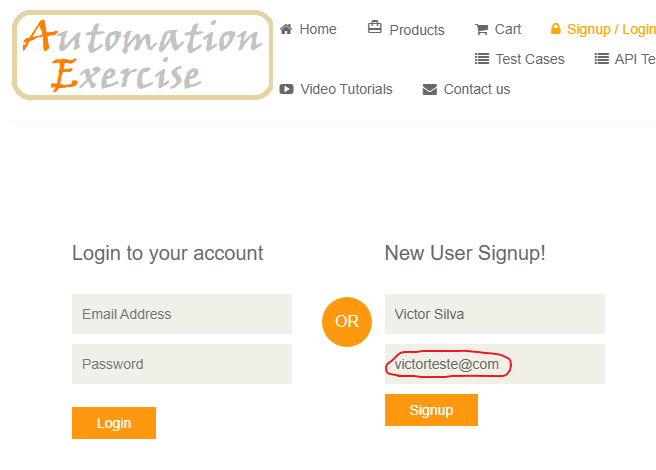
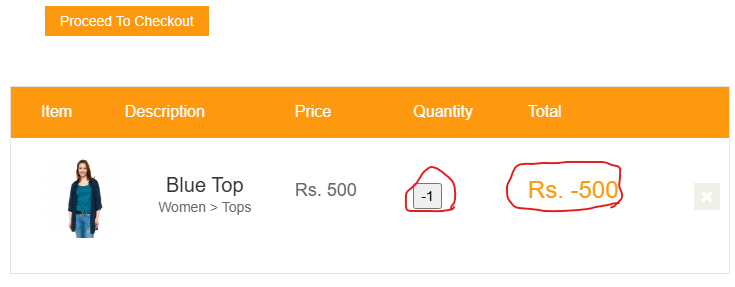
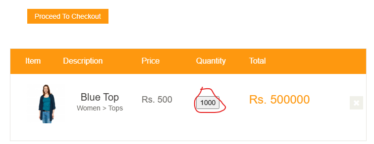

# Relatório de Defeitos (Bug Reports) — Automation Exercise

| Metadados do Documento | Detalhes |
| :--- | :--- |
| **Projeto / Produto** | Automation Exercise (E-commerce Web & API) |
| **Ciclo de Execução** | Test Run 11/23/2026, qa-portfolio-automation-exercise |
| **Ferramenta de Tracking** | Jira |
| **Autor (QA)** | Victor Eduardo Sousa Silva |

---

## Resumo Executivo de Defeitos

| ID Bug | Jira Key | Caso de Teste | Título Resumido | Severidade | Prioridade | Status |
| :--- | :---: | :---: | :--- | :---: | :---: | :---: |
| **BUG-01** | `QPAE-1` | `CT-02` | Sistema permitiu formato de email inválido | Critical | Alta | Aberto |
| **BUG-02** | `QPAE-2` | `CT-07` | Sistema permite inserir valores negativos para produtos selecionados | Critical | Alta | Aberto |
| **BUG-03** | `QPAE-3` | `CT-08` | Sistema permite inserir uma quantidade acima do limite permitido | Critical | Alta | Aberto |

---

## Detalhamento dos Defeitos

### BUG-01 | [Exemplo] [Autenticação] Sistema permitiu formato de email inválido

* **Jira Issue:** `QPAE-1`
* **Caso de Teste Relacionado:** `CT-02`
* **Módulo:** Autenticação
* **Severidade:** High
* **Prioridade:** high
* **Ambiente:** Windows 11 | Google Chrome atual | `https://automationexercise.com/`

#### Descrição
Ao digitar um endereço de e-mail inválido no campo de inscrição da Newsletter e clicar no botão Signup, o sistema avança para a próxima etapa do cadastro

#### Passos para Reproduzir (Steps to Reproduce)
1. Acessar a página inicial `https://automationexercise.com/`.
2. Informar um nome válido na seção New User Signup!
3. Inserir um e-mail inválido (`teste@com`) no campo `Your email address`.
4. Clicar em Signup.
5. Verificar o comportamento da validação.

#### Resultado Atual
o sistema avança para a próxima etapa do cadastro

#### Resultado Esperado
Sistema deve impedir o avanço do cadastro enquanto o endereço de e-mail estiver em formato inválido.

#### Evidência
s

---

## Detalhamento dos Defeitos

### BUG-02 | [Exemplo] [Produtos] Sistema permite inserir valores negativos para produtos selecionados

* **Jira Issue:** `QPAE-2`
* **Caso de Teste Relacionado:** `CT-07`
* **Módulo:** Produtos
* **Severidade:** High
* **Prioridade:** high
* **Ambiente:** Windows 11 | Google Chrome atual | `https://automationexercise.com/`

#### Descrição
Ao inserir um valor negativo por exemplo -1 para o produto selecionado, o sistema permite que o valor negativo seja inserido.

#### Passos para Reproduzir (Steps to Reproduce)
1. Acessar o catálogo de produtos.
2. Selecionar um produto para visualizar seus detalhes.
3. Localizar o campo de quantidade.
4. Tentar informar a quantidade -1.
5. Tentar adicionar o produto ao carrinho.

#### Resultado Atual
O produto é adicionado ao carrinho com um valor negativo inserido

#### Resultado Esperado
Sistema não deve permitir a inclusão de produtos com quantidades negativas no carrinho.

#### Evidência
s

---

## Detalhamento dos Defeitos

### BUG-03 | [Exemplo] [Produtos] Sistema permite inserir uma quantidade acima do limite permitido

* **Jira Issue:** `QPAE-3`
* **Caso de Teste Relacionado:** `CT-08`
* **Módulo:** Produtos
* **Severidade:** High
* **Prioridade:** high
* **Ambiente:** Windows 11 | Google Chrome atual | `https://automationexercise.com/`

#### Descrição
Ao inserir um valor acima do valor permitido por exemplo +999 o sistema permite avançar para a próxima etapa

#### Passos para Reproduzir (Steps to Reproduce)
1. Acessar o catálogo de produtos.
2. Selecionar um produto para visualizar seus detalhes.
3. Localizar o campo de quantidade.
4. Tentar informar a quantidade 1000.
5. Tentar adicionar o produto ao carrinho.
6. Verificar a quantidade adicionada ao carrinho.

#### Resultado Atual
O produto é adicionado ao carrinho com um valor acima do permitido

#### Resultado Esperado
Sistema deve respeitar o limite máximo de quantidade estabelecido para o produto.

#### Evidência
s